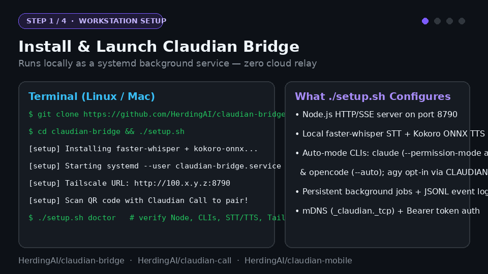
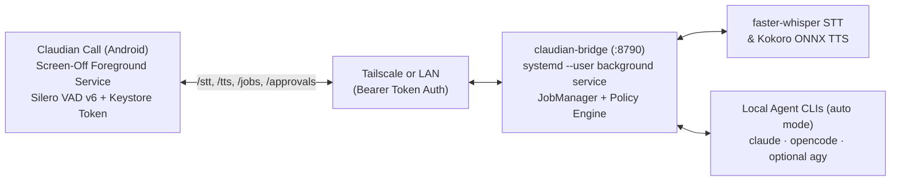

# Claudian Bridge

**Talk to your workstation's Claude Code or OpenCode from your phone — screen off, zero cloud relay.**



`claudian-bridge` is a lightweight Node.js HTTP/SSE server that runs as a background service (`systemd --user`) on your PC and exposes **Claude Code** (`claude`), **OpenCode** (`opencode`), optional **Antigravity** (`agy`), local **faster-whisper STT**, and local **Kokoro ONNX TTS** to **[Claudian Call](https://github.com/HerdingAI/claudian-call)** (Android) and **[Claudian Mobile](https://github.com/HerdingAI/claudian-mobile)** (Obsidian) over Tailscale or LAN.



---

## Start Here as User #1 (Step-by-Step)

### Step 1 — Install & Launch the Bridge on Your Workstation

You do **not** run a desktop GUI app for the bridge — `./setup.sh` installs a local background service (`claudian-bridge.service`) that starts automatically and stays running.

```bash
git clone https://github.com/HerdingAI/claudian-bridge.git
cd claudian-bridge
./setup.sh
```

What `./setup.sh` sets up automatically:
1. Creates `~/.venvs/audio` and installs `faster-whisper`, `kokoro-onnx`, `soundfile`, and `qrcode`.
2. Downloads Kokoro v1.0 ONNX voice models (`~90 MB`) into `~/.cache/claudian-bridge/models/kokoro/`.
3. Generates a Bearer auth token at `~/.config/claudian-bridge/config.json` (`0600`).
4. Installs and starts `systemd --user` (`claudian-bridge.service`) on Linux with `Restart=always` (or starts in the background when `systemd --user` is unavailable).
5. Advertises `_claudian._tcp.local` via mDNS for LAN auto-discovery and prints a **scannable QR code** (`claudian://pair?url=...&token=...`).

> **Optional flags & commands:**
> - `./setup.sh --with-compound-engineering` — Opt-in install of Compound Engineering slash commands (`ce-*`, `lfg`) and instructions into `CLAUDE.md` / `AGENTS.md` / `GEMINI.md`.
> - `./setup.sh doctor` — Verifies Node.js, CLIs on `PATH`, audio venv, auth token, Tailscale IP, and bridge `/health`.
> - `./setup.sh devices` / `./setup.sh devices revoke <id>` — Lists or revokes paired per-device tokens.
> - `systemctl --user status claudian-bridge.service` / `systemctl --user restart claudian-bridge.service` — Check or restart the background service.
> - `node server.mjs` — Run manually in foreground without `systemd`.

---

### Step 2 — Install & Pair the Android App (**Claudian Call**)

1. **Network**: Install [Tailscale](https://tailscale.com/) on both your workstation and phone (or connect both to the same Wi-Fi LAN).
2. **Install App**: Download the latest `claudian-call` APK (`v0.6.9+`) from **[Claudian Call Releases](https://github.com/HerdingAI/claudian-call/releases)** (or F-Droid).
   > *Upgrading from an older pre-M1 APK (`<= build 14`)?* Because `/apk` now requires Bearer auth, install `v0.6.9` once from GitHub Releases or via `adb install`; subsequent in-app **Check for App Update** downloads authenticate automatically and verify SHA-256 + signing certificate.
3. **Pair in 1 Tap**:
   - Open **Claudian Call** and tap **Scan QR Code** to scan the QR code printed by `./setup.sh` (or tap **Auto-Discover LAN** on Wi-Fi).
   - Confirm **"Pair with this computer?"** -> tap **Pair**. Your token is encrypted in `AndroidKeyStore`.
4. **Talk Screen-Off**:
   - Grant Microphone, Notifications, and Nearby Devices permissions when prompted.
   - Pick your workspace (`📁 <folder> ▾`) and provider/model (`claude` / `opencode`), then tap **Call** and lock your phone.

---

### Step 3 — Background Jobs, Non-Interrupting Voice & Approvals

- **Auto Mode**: Every harness runs non-interactively in auto mode (`claude --permission-mode auto`, `opencode --auto`, `agy --mode auto`).
- **Survives Drops & Hang-Ups**: Turns run as persistent background jobs (`POST /jobs` with `Idempotency-Key` + JSONL event logs). Dropping signal or hanging up does **not** kill your agent; reconnecting replays missed events via `Last-Event-ID`.
- **Non-Interrupting Turn Queue**: Default `1800 ms` silence window (`200 ms` min speech, `bargeIn = false`). If you speak while the agent is thinking, your follow-up queues cleanly instead of aborting the active turn.
- **Voice Permission Broker**: Reads/edits inside your workspace are allowed; outside-workspace reads (`~/.ssh`) are denied and audited; risky shell or network actions prompt `"Allow?"` in plain English so you can reply `"Yes"` or `"No"` by voice.

---

## Configuration (Environment Variables)

- `CLAUDIAN_BRIDGE_PORT` (default: `8790`)
- `CLAUDIAN_BIND` / `CLAUDIAN_BRIDGE_HOST` (default: `0.0.0.0` — un-hardcoded so LAN, Tailscale, and emulators work out of the box; set `CLAUDIAN_BIND=<tailscale-ip>` or `127.0.0.1` to restrict)
- `CLAUDIAN_WORKSPACE_DIR` (default: `~/dev` if present, else `$HOME`)
- `CLAUDIAN_WORKSPACES_ROOT` (root directory scanned by `GET /workspaces` and enforced by `realpath` confinement)
- `CLAUDIAN_OBSIDIAN_VAULT` (target vault for `POST /vault/save`)
- `CLAUDIAN_ENABLE_AGY` (default: `0`; set `1` to enable Antigravity `agy`)
- `CLAUDIAN_MAX_CONCURRENT_JOBS` (default: `3`)
- `CLAUDIAN_JOB_HANG_MS` (default: `300000` / 5 min)
- `CLAUDIAN_APPROVAL_TIMEOUT_MS` (default: `600000` / 10 min)
- `CLAUDIAN_STT_MODEL` (default: `small`)
- `CLAUDIAN_CLAUDE_BIN` / `CLAUDIAN_OPENCODE_BIN` / `CLAUDIAN_AGY_BIN` / `CLAUDIAN_STT_PYTHON`

## HTTP / SSE Endpoints

- `GET /health` — Unauthenticated returns `{ ok, version }`; authenticated returns full readiness (`vault`, `claude`, `agy`, `opencode`, `stt`, `tts`)
- `GET /apk/version` & `GET / HEAD /apk` — Authenticated APK metadata (`versionCode`, `versionName`, `size`, `sha256`) and binary stream
- `GET / POST /workspaces` — Lists or creates workspace folders inside `CLAUDIAN_WORKSPACES_ROOT`
- `GET /models?provider=claude|agy|opencode` — Lists available models
- `GET /sessions?cwd=...`, `GET /sessions/:id/messages`, `POST /sessions/:id/recap` — Workspace-scoped session history & 5s spoken recap
- `POST /jobs`, `GET /jobs`, `GET /jobs/:id`, `GET /jobs/:id/events`, `POST /jobs/:id/cancel`, `POST /jobs/:id/message` — Persistent background jobs with `Idempotency-Key` & `Last-Event-ID` replay
- `GET /approvals`, `POST /approvals/:id` — Pending permission requests (`allow` | `deny`)
- `GET /devices`, `POST /devices`, `DELETE /devices/:id` — Per-device token management
- `POST /chat` — Legacy SSE wrapper (client disconnect no longer kills the agent)
- `POST /stt` & `POST /tts` — `faster-whisper` transcription and Kokoro ONNX synthesis
- `POST /vault/save` — Saves dated Markdown notes to `<CLAUDIAN_OBSIDIAN_VAULT>/Voice Notes/`

## Documentation & Links

- **[SECURITY.md](SECURITY.md)** — Threat model, token storage, workspace confinement, and audit logging
- **[TROUBLESHOOTING.md](TROUBLESHOOTING.md)** — Setup, audio, Tailscale, and APK update troubleshooting
- **[Claudian Call](https://github.com/HerdingAI/claudian-call)** — Native Android screen-off voice app
- **[Claudian Mobile](https://github.com/HerdingAI/claudian-mobile)** — Cross-platform Obsidian plugin (iOS, Android, Desktop)

## License

MIT — see [LICENSE](LICENSE).
